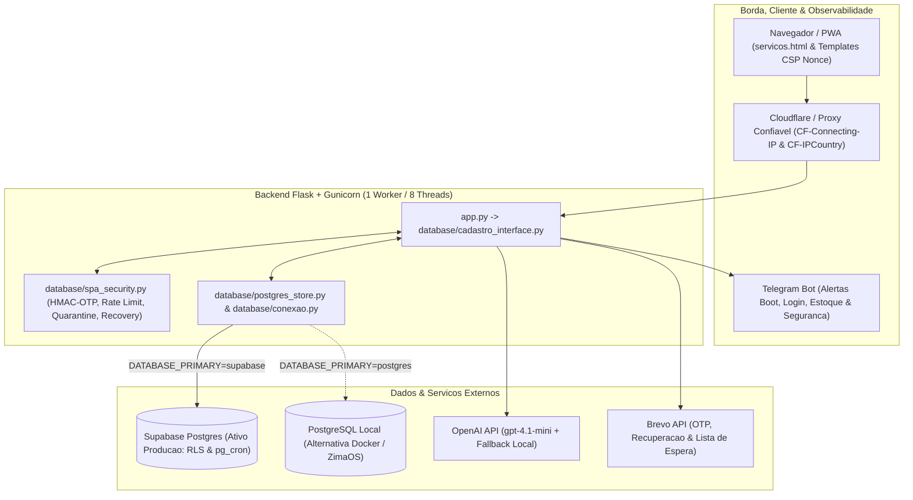
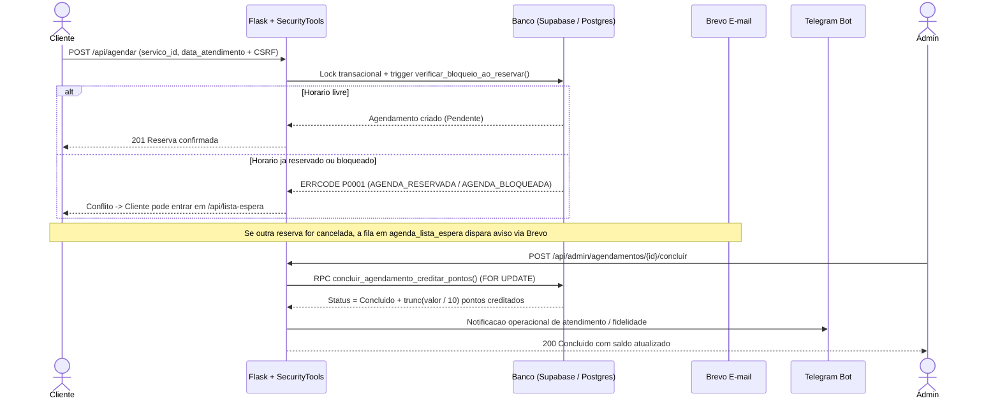
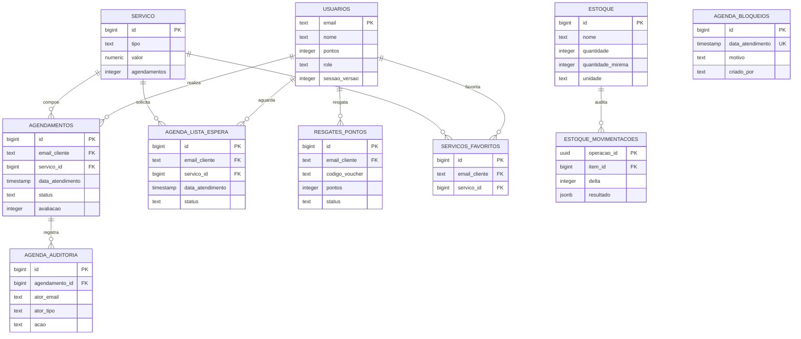

<a id="topo"></a>

<div align="center">


<br/>

<p>
  <a href="https://github.com/maquiszz/tcc-ciencia-de-dados/commits/main">
    
  </a>
  
  
  
  
  
  
  
</p>

<table>
  <tr>
    <td align="center" width="190">
      <br/>
      <strong>50 Rotas</strong><br/>
      <sub>Web, Auth, Cliente, Admin &amp; PWA</sub><br/><br/>
    </td>
    <td align="center" width="190">
      <br/>
      <strong>68 Testes</strong><br/>
      <sub>49 Python + 19 JavaScript/CSP</sub><br/><br/>
    </td>
    <td align="center" width="190">
      <br/>
      <strong>10 Entidades</strong><br/>
      <sub>Modelagem transacional com RLS</sub><br/><br/>
    </td>
    <td align="center" width="190">
      <br/>
      <strong>100% CSP-Safe</strong><br/>
      <sub>Scripts por Nonce &amp; zero inline</sub><br/><br/>
    </td>
  </tr>
</table>

<p>
  <a href="#-sobre-o-projeto">Sobre</a> •
  <a href="#-funcionalidades">Funcionalidades</a> •
  <a href="#-engenharia-e-segurança">Engenharia &amp; Segurança</a> •
  <a href="#-arquitetura-e-diagramas">Arquitetura &amp; Diagramas</a> •
  <a href="#-stack-e-estrutura">Stack &amp; Estrutura</a> •
  <a href="#-endpoints-da-api">API</a> •
  <a href="#-como-executar-e-testar">Executar &amp; Testar</a> •
  <a href="#-produção-e-sql">Produção &amp; SQL</a>
</p>

</div>

---

## ✨ Sobre o Projeto

O **Spa Panaceia** é a aplicação web completa desenvolvida para o **TCC de Ciência de Dados** (`tcc-ciencia-de-dados`), desenhada para ir muito além de um site institucional: ela integra **experiência de cliente (PWA + tema Claro/Escuro + IA)** com **operações transacionais seguras em produção** para reservas, lista de espera, fidelidade, estoque, auditoria e telemetria administrativa.

> [!IMPORTANT]
> **Integridade sem *split-brain* entre bancos:** o backend suporta **Supabase** (produção ativa verificada no Render) e **PostgreSQL local** (alternativa Docker/ZimaOS), tratados como bases independentes. Por padrão, `DATABASE_FAILOVER_ENABLED=false` impede gravações silenciosas e divergentes caso um banco fique indisponível.

> [!TIP]
> **Código legível + ativos otimizados:** os arquivos-fonte (`database/servicos.html`, `templates/*.html`, `static/css/*.css`, `static/js/*.js`) permanecem limpos para edição e geram cópias minificadas `.min.*` via `scripts/build_frontend.py` com zero minificador em runtime.

---

## 🚀 Funcionalidades

<table width="100%">
  <tr>
    <td width="50%" valign="top">

### 🪷 Experiência do Cliente (Web & PWA)
- **Catálogo Interativo & Microinterações:** apresentação fluida dos tratamentos com alternância de tema Claro/Escuro, animações sutis e carregamento otimizado (`/api/servicos`).
- **Favoritos & Repetir Agendamento:** marque tratamentos preferidos (`/api/favoritos`) e refaça reservas anteriores com um clique.
- **Agendamento Inteligente:** calendário `Flatpickr`, verificação em tempo real de horários ocupados/bloqueados (`/api/horarios-ocupados`) e sincronia com relógio oficial (`/api/relogio`).
- **Avaliações Pós-Atendimento:** clientes avaliam sessões concluídas em `/api/agendamentos/<id>/avaliar`.
- **PWA Instalável & LGPD:** manifesto `/manifest.webmanifest`, service worker `/spa-sw.js`, política em `/privacidade` e exportação dos próprios dados (`/api/privacidade/exportar`).

    </td>
    <td width="50%" valign="top">

### 📊 Gestão Executiva & Operação
- **Dashboard Analítico (`/api/admin/analytics`):** KPIs por período (`30d` ou janela personalizada), receita por tratamento e acompanhamento operacional.
- **Gestão Completa de Agenda & Bloqueios:** painel administrativo (`/api/admin/agendamentos`), bloqueio/desbloqueio de horários (`/api/admin/bloqueios`) e histórico de alterações (`agenda_auditoria`).
- **Conclusão Transacional & Vouchers:** baixa segura de reservas (`/api/admin/agendamentos/<id>/concluir`) e validação de vouchers no balcão (`/api/admin/vouchers/utilizar`).
- **Estoque Atômico & Idempotente:** controle de entradas/saídas protegido contra cliques duplos e timeouts (`PUT /api/estoque/<id>/movimentar`).
- **Conversor Desktop CSV → XLSX:** utilitário auxiliar em [`dashboards/interface.py`](dashboards/interface.py) para estilização automática de planilhas com `OpenPyXL`.

    </td>
  </tr>
  <tr>
    <td width="50%" valign="top">

### 💎 Fidelidade, Automação & Concierge IA
- **Clube de Fidelidade Real:** crédito automático e atômico de **`trunc(valor / 10)` pontos** ao concluir um atendimento, sem depender de cálculo vindo do navegador.
- **Resgate de Vouchers:** acompanhamento de saldo (`/api/usuario/pontos`), catálogo de recompensas (`/api/fidelidade`) e emissão em `/api/fidelidade/resgatar`.
- **Lista de Espera + Brevo API:** interessados em horários lotados entram em fila (`/api/lista-espera`) e são avisados por e-mail quando surge uma vaga.
- **Limpeza Automática (`pg_cron`):** rotina a cada 15 minutos no Supabase cancela reservas pendentes vencidas com registro automático na auditoria.
- **Concierge Virtual com IA (`/api/chat`):** atendimento consultivo em português via **OpenAI (`gpt-4.1-mini`)** com **fallback local automático**.

    </td>
    <td width="50%" valign="top">

### 🎯 Defesa Ativa & Telemetria em Tempo Real
- **Hardening de Conta & Sessão:** OTP protegido por **HMAC-SHA256**, tokens assinados com expiração persistente no banco e invalidação global via `sessao_versao`.
- **Anti-Scanner & Quarentena Imediata:** bloqueio automático instantâneo para *probes* conhecidos e User-Agents ofensivos com trilha em log estruturado.
- **Proxy Confiável & Cloudflare:** leitura segura de IP real via `CF-Connecting-IP` restrita a `TRUSTED_PROXY_IPS`, filtro opcional por país (`CF-IPCountry`) e bloqueio por CIDR.
- **CSP Estrita + Zero Inline:** scripts autorizados exclusivamente por **`nonce` dinâmico**, sem `eval` e sem atributos HTML `on*=`.
- **Alertas Instantâneos no Telegram:** notificações operacionais de boot, logins (com IP/origem e dispositivo), estoque, contas, fidelidade, avaliações, LGPD e incidentes.

    </td>
  </tr>
</table>

---

## 🔒 Engenharia e Segurança

<details open>
<summary><strong>4 Diferenciais de Engenharia Aplicados no Código</strong></summary>

1. **Agenda à prova de concorrência (`pg_advisory_xact_lock` + Triggers bidirecionais):**
   reservas simultâneas e bloqueios administrativos adquirem o mesmo lock transacional por timestamp e respeitam o índice único parcial `uq_agendamentos_horario_ativo`, impedindo duas reservas ativas ou reserva em horário bloqueado.
2. **Estoque imune a duplo clique e falha de rede (`operacao_id` UUID):**
   o navegador mantém a mesma chave UUID até conclusão definitiva; a RPC `movimentar_estoque` registra o resultado na tabela `estoque_movimentacoes` na mesma transação do saldo e recusa reutilização divergente ou saldo negativo (`CHECK (quantidade >= 0)`).
3. **Frontend CSP-Safe validado por testes automatizados:**
   ações interativas usam despachante declarativo (`data-onclick`) validado por `tests/csp-declarative-events.test.js` tanto nos fontes quanto nas builds `.min.html`.
4. **Central de Alertas no Telegram + IP Real Cloudflare:**
   `cadastro_interface.py` captura o endereço real via proxy confiável, identifica origem/dispositivo e dispara notificações para **Boot do Servidor**, **Logins**, **Cadastro/Contas**, **Estoque**, **Fidelidade/Vouchers**, **Avaliações**, **Exportações LGPD** e **Quarentena de Segurança**.

</details>

---

## 🧩 Arquitetura e Diagramas

### 1. Arquitetura em Camadas e Integrações



### 2. Fluxo Transacional: Reserva, Lista de Espera e Conclusão com Pontos



### 3. Modelo Entidade-Relacionamento (`erDiagram`)



---

## 📦 Stack e Estrutura

| Camada | Tecnologias Verificadas |
| :--- | :--- |
| **Backend & Runtime** | Python `3.12`, Flask `3.1.0`, Gunicorn `23.0.0`, `Werkzeug 3.1.3`, `flask-cors 5.0.0`, `python-dotenv 1.1.1` |
| **Dados & Analytics** | Supabase (`supabase==2.31.0`), PostgreSQL (`psycopg2-binary==2.9.11`), `pandas 3.0.3`, `numpy 2.4.6`, `openpyxl 3.1.5` |
| **IA & Mensageria** | OpenAI (`openai==1.61.1`, modelo padrão `gpt-4.1-mini`), Brevo API (`requests==2.34.2`), Telegram Bot API |
| **Frontend & PWA** | HTML5 + CSS3 + JS CSP-safe (`nonce`), `Inter` & `Manrope`, `Flatpickr 4.6.13` (SRI), Service Worker & Manifest PWA |
| **Build & Qualidade** | `minify-html==0.18.1`, `unittest` (`49` testes Python), `node:test` (`19` testes JS), Docker (`python:3.12-slim`), `Procfile` |

<details>
<summary><strong>Árvore completa de arquivos do repositório</strong></summary>

```text
projeto-site/
├── app.py                              # Entrypoint único Gunicorn/Flask (app:app)
├── database/
│   ├── cadastro_interface.py           # Rotas web, API cliente/admin, analytics, segurança e Telegram
│   ├── spa_security.py                 # HMAC-OTP, tokens de recuperação, sessões e quarentena anti-scanner
│   ├── postgres_store.py / conexao.py  # Persistência PostgreSQL local & cliente Supabase
│   ├── multiplos_usuarios.py           # Rotinas operacionais multiusuário
│   ├── servicos.html / .min.html       # Portal principal do Spa (catálogo, agenda, clube, painel admin)
│   └── index.html
├── templates/                          # index, privacidade, 404 (+ cópias .min.html)
├── static/
│   ├── css/                            # privacy-notice.css / .min.css
│   ├── js/                             # privacy-notice.js, registration.js (+ cópias .min.js)
│   └── img/                            # logo_panaceia.png
├── scripts/
│   └── build_frontend.py               # Minifica HTML/CSS/JS mantendo os fontes legíveis
├── migrations/
│   └── 001_security_hardening.sql      # Expiração e contagem persistentes de OTP/recuperação + sessao_versao
├── dashboards/
│   └── interface.py                    # Utilitário desktop Tkinter + OpenPyXL (CSV -> XLSX estilizado)
├── tests/                              # 49 testes Python (unittest) + 19 testes JS (node:test)
├── Dockerfile & Procfile               # Container não-root (usuário spa, porta 5000) e comando Render
├── requirements.txt                    # Dependências de runtime
└── requirements-build.txt              # Dependência isolada de build frontend
```

</details>

---

## 📡 Endpoints da API

| Grupo | Rotas Principais | Finalidade |
| :--- | :--- | :--- |
| **Público, SEO & PWA** | `GET /`, `/cadastro`, `/privacidade`, `/robots.txt`, `/sitemap.xml`, `/api/health`, `/manifest.webmanifest`, `/spa-sw.js`, `/app-icon.svg` | Portal principal, diagnóstico de saúde/banco/Telegram, SEO canônico e suporte PWA |
| **Catálogo & Agenda** | `GET /api/servicos`, `GET /api/horarios-ocupados`, `GET /api/relogio` | Listagem de tratamentos, disponibilidade em tempo real e hora oficial |
| **Conta & Segurança** | `POST /cadastrar`, `/api/validar-codigo`, `/api/reenviar-codigo`, `/api/login`, `/api/logout`, `/api/esqueci-senha`, `/api/redefinir-senha`, `GET /api/me` | Cadastro com OTP por e-mail, login, recuperação assinada e controle de sessão |
| **Área do Cliente** | `POST /api/agendar`, `GET /api/meus-agendamentos`, `PUT/DELETE /api/agendamentos/<id>`, `POST .../avaliar`, `GET/POST/DELETE /api/lista-espera`, `GET/POST/DELETE /api/favoritos/<id>` | Reservas, remarcação/cancelamento, avaliações, espera e favoritos |
| **Fidelidade, IA & LGPD** | `GET /api/usuario/pontos`, `GET /api/fidelidade`, `POST /api/fidelidade/resgatar`, `GET /api/privacidade/exportar`, `POST /api/chat` | Pontuação, vouchers, exportação de dados do titular e Concierge IA |
| **Administração** | `GET /api/admin/agendamentos`, `GET /api/admin/analytics`, `GET/POST/DELETE /api/admin/bloqueios`, `GET /api/admin/agendamentos/<id>/historico`, `POST .../concluir`, `POST /api/admin/vouchers/utilizar`, `GET /api/admin/usuarios`, `GET/POST /api/estoque`, `PUT /api/estoque/<id>/movimentar`, `DELETE /api/estoque/<id>` | Gestão completa da agenda, analytics, conclusão transacional, vouchers e estoque |

---

## ⚡ Como Executar e Testar

### 1. Rodar Localmente (Desenvolvimento)

> Configure antes um banco válido (`DB_*` para PostgreSQL local **ou** `SUPABASE_URL` + `SUPABASE_SERVICE_ROLE_KEY`). Em HTTP local sem TLS, mantenha `APP_ENV=development` e `SESSION_COOKIE_SECURE=false`.

```powershell
python -m pip install -r requirements.txt
$env:APP_ENV = "development"
$env:SESSION_COOKIE_SECURE = "false"
python app.py
```

### 2. Recompilar Ativos Minificados (Frontend)

Sempre que editar arquivos em `database/servicos.html`, `templates/` ou `static/`, regenere e versionamento as cópias `.min.*`:

```bash
python -m pip install -r requirements-build.txt
python scripts/build_frontend.py
```

### 3. Executar a Suíte Completa (68 Testes)

```bash
# 49 testes Python (rotas públicas, segurança, projeção PostgreSQL, contratos e validação de estoque)
python -m unittest discover -s tests -p "test_*.py"

# 19 testes Node.js (CSP sem inline handlers, cadastro, perfil paralelo e idempotência de estoque)
node --test tests/*.test.js
```

### 4. Subir com Docker

```bash
docker build -t spa-panaceia .
docker run -d --name panaceia-spa --restart unless-stopped -p 5000:5000 --env-file database.env spa-panaceia
```

---

## 📚 Produção e SQL

Todo o detalhamento operacional de produção (Render + Supabase), alternativa Docker/ZimaOS e scripts SQL completos com triggers, locks e `pg_cron` está organizado abaixo:

<details>
<summary><strong>1. Estado do Deploy Verificado & Regras dos Dois Bancos</strong></summary>

- **Deploy ativo verificado:** Render com Flask servido por Gunicorn (`Procfile`: 1 worker e 8 threads).
- **Banco primário em produção:** Supabase (`DATABASE_PRIMARY=supabase`, `DATABASE_FAILOVER_ENABLED=false`).
- **PostgreSQL local em Docker/ZimaOS:** alternativa operacional documentada; os dois bancos não são réplicas e não possuem sincronização automática.
- **Verificação pública pré-publicação em 07/10/2026:**
  - `https://spa-panaceia.onrender.com/` respondeu HTTP `200` com TLS válido e healthcheck confirmando Supabase ativo.
  - `https://spapanaceia.com.br/` e `https://www.spapanaceia.com.br/` retornaram HTTP `530` do Cloudflare na ocasião (TLS até a borda válido; origem própria dependente de revisão de DNS/Cloudflare).
  - `https://panaceia.onrender.com/` refere-se a um serviço separado (`PANACEIA`), não ao serviço `Spa Panaceia`.
- **SEO & Privacidade:** `PUBLIC_SITE_URL` só emite canonical, `og:url` e sitemap quando a URL HTTPS aponta para um host confiável pelo backend (caso contrário `/sitemap.xml` responde `503` deliberadamente). Analytics permanece desativado por padrão.

</details>

<details>
<summary><strong>2. Variáveis de Ambiente (.env) & Hardening de Proxy Cloudflare</strong></summary>

No Render, configure `DATABASE_PRIMARY=supabase`, `DATABASE_FAILOVER_ENABLED=false`, `SUPABASE_URL`, `SUPABASE_SERVICE_ROLE_KEY` e `FLASK_SECRET_KEY` diretamente nas variáveis de ambiente do serviço. O exemplo abaixo representa a configuração para a alternativa local/Docker com `database.env` fora do Git — **nunca insira segredos reais no repositório**:

```env
APP_ENV=production
FLASK_SECRET_KEY=<segredo-aleatorio-longo>

DB_HOST=postgres
DB_PORT=5432
DB_NAME=site_db
DB_USER=site_user
DB_PASSWORD=<senha-exclusiva-do-site>
DB_CONNECT_TIMEOUT=10
DB_POOL_MIN=1
DB_POOL_MAX=10

# Banco principal e cooldown antes de testar novamente um banco offline.
DATABASE_PRIMARY=postgres
DATABASE_FAILOVER_ENABLED=false
DB_FAILOVER_COOLDOWN_SECONDS=60

# Contingência Supabase. A service role fica somente no backend.
SUPABASE_URL=https://SEU-PROJETO.supabase.co
SUPABASE_SERVICE_ROLE_KEY=<service-role-do-servidor>

SPA_TIMEZONE=America/Sao_Paulo
SESSION_COOKIE_SECURE=true
SESSION_COOKIE_SAMESITE=Lax
SESSION_TTL_HOURS=12

CORS_ORIGINS=https://spapanaceia.com.br,https://www.spapanaceia.com.br
TRUSTED_HOSTS=spapanaceia.com.br,www.spapanaceia.com.br,localhost,127.0.0.1
TRUSTED_PROXY_IP_HEADER=CF-Connecting-IP
# CIDRs dos proxies que realmente chegam ao container (mantenha a lista atualizada).
TRUSTED_PROXY_IPS=<cidr-do-proxy-1>,<cidr-do-proxy-2>
# Opcional: IPs/redes a bloquear diretamente no backend.
BLOCKED_IP_CIDRS=<ip-ou-cidr-bloqueado>
# Opcional: restringe o site aos países informados; só funciona atrás do proxy confiável.
# ALLOWED_COUNTRIES=BR
# Opcional: cabeçalho definido pelo proxy confiável para tráfego VPN/anônimo.
# TRUSTED_VPN_HEADER=X-Spa-VPN

BREVO_API_KEY=<chave-brevo>
BREVO_SENDER_NAME=Spa Panaceia
BREVO_SENDER_EMAIL=<remetente-verificado>
SPA_ALERT_EMAIL=<caixa-da-equipe-que-recebe-alertas>

# Alertas operacionais e de segurança no Telegram
TELEGRAM_BOT_TOKEN=<token-do-bot-telegram>
TELEGRAM_CHAT_ID=<id-do-chat-telegram>

OPENAI_API_KEY=<chave-openai>
OPENAI_MODEL=gpt-4.1-mini
LOG_LEVEL=INFO
```

**Regras operacionais de proxy & segurança:**
- O backend **não** usa chave `anon`/publicável como credencial do servidor (`SUPABASE_SERVICE_ROLE_KEY` apenas; o nome legado `service_role` ainda é aceito temporariamente).
- `CF-Connecting-IP` só é aceito quando `REMOTE_ADDR` pertence a `TRUSTED_PROXY_IPS` ([faixas oficiais Cloudflare](https://developers.cloudflare.com/fundamentals/concepts/cloudflare-ip-addresses/)).
- `TRUSTED_HOSTS` recusa qualquer `Host` fora da lista com HTTP `400`.
- `ALLOWED_COUNTRIES=BR` exige `CF-IPCountry` no Cloudflare atrás de proxy confiável; `TRUSTED_VPN_HEADER` depende de regra de proxy/WAF.
- Como rate limiting e bloqueio adaptativo operam na memória do único worker Gunicorn, mantenha proteção de WAF/limite de requisições também na borda.

</details>

<details>
<summary><strong>3. Atualização & Diagnóstico em Produção no ZimaOS</strong></summary>

Confirme que `TELEGRAM_BOT_TOKEN` e `TELEGRAM_CHAT_ID` estão no `database.env` sem `\r\n` (CRLF):

```bash
cd /DATA/AppData/projetos/tcc-ciencia-de-dados && git stash && git pull origin main && sudo docker --config /DATA/.docker image build --no-cache -t tcc-panaceia . && (sudo docker stop panaceia-spa; sudo docker rm panaceia-spa) && sudo docker run -d --name panaceia-spa --restart unless-stopped -p 5000:5000 --env-file /DATA/AppData/projetos/tcc-ciencia-de-dados/database.env tcc-panaceia
```

Verificação pós-deploy:

```bash
curl -fsS http://127.0.0.1:5000/api/health
sudo docker logs --tail 50 panaceia-spa
```

Saída esperada: `"telegram_configurado": true`, `INFO:spa.telegram:Notificações do Telegram configuradas` e `INFO:spa.telegram:Alerta entregue ao Telegram com sucesso`.

</details>

<details>
<summary><strong>4. SQL — Lista de Espera, Auditoria e Bloqueio de Horários (Supabase / Postgres)</strong></summary>

No PostgreSQL local as tabelas são criadas no startup; no **Supabase**, execute no **SQL Editor** uma vez (RLS habilitado sem acesso para `anon`/`authenticated`):

```sql
CREATE TABLE IF NOT EXISTS public.agenda_lista_espera (
    id BIGSERIAL PRIMARY KEY,
    email_cliente TEXT NOT NULL,
    servico_id BIGINT NOT NULL,
    data_atendimento TIMESTAMP WITHOUT TIME ZONE NOT NULL,
    status TEXT NOT NULL DEFAULT 'Aguardando'
        CHECK (status IN ('Aguardando', 'Notificando', 'Notificado', 'Cancelado')),
    criado_em TIMESTAMPTZ NOT NULL DEFAULT NOW(),
    notificado_em TIMESTAMPTZ
);
CREATE UNIQUE INDEX IF NOT EXISTS uq_agenda_lista_espera_email_horario
    ON public.agenda_lista_espera (email_cliente, data_atendimento)
    WHERE status IN ('Aguardando', 'Notificando', 'Notificado');
CREATE INDEX IF NOT EXISTS ix_agenda_lista_espera_horario_status
    ON public.agenda_lista_espera (data_atendimento, status);

CREATE TABLE IF NOT EXISTS public.agenda_auditoria (
    id BIGSERIAL PRIMARY KEY,
    agendamento_id BIGINT NOT NULL,
    ator_email TEXT NOT NULL,
    ator_tipo TEXT NOT NULL CHECK (ator_tipo IN ('admin', 'cliente')),
    acao TEXT NOT NULL,
    data_anterior TEXT,
    data_nova TEXT,
    status_anterior TEXT,
    status_novo TEXT,
    criado_em TIMESTAMPTZ NOT NULL DEFAULT NOW()
);
ALTER TABLE public.agenda_auditoria
    ADD COLUMN IF NOT EXISTS status_anterior TEXT,
    ADD COLUMN IF NOT EXISTS status_novo TEXT;
CREATE INDEX IF NOT EXISTS ix_agenda_auditoria_agendamento_data
    ON public.agenda_auditoria (agendamento_id, criado_em DESC);

ALTER TABLE public.agenda_lista_espera ENABLE ROW LEVEL SECURITY;
ALTER TABLE public.agenda_auditoria ENABLE ROW LEVEL SECURITY;
REVOKE ALL ON public.agenda_lista_espera, public.agenda_auditoria FROM PUBLIC, anon, authenticated;
GRANT ALL ON public.agenda_lista_espera, public.agenda_auditoria TO service_role;
GRANT USAGE, SELECT ON SEQUENCE public.agenda_lista_espera_id_seq, public.agenda_auditoria_id_seq TO service_role;
```

**Bloqueio de horários e triggers bidirecionais anti-duplicidade (`pg_advisory_xact_lock`):**

```sql
CREATE TABLE IF NOT EXISTS public.agenda_bloqueios (
    id BIGSERIAL PRIMARY KEY,
    data_atendimento TIMESTAMP WITHOUT TIME ZONE NOT NULL,
    motivo TEXT NOT NULL,
    criado_por TEXT NOT NULL,
    criado_em TIMESTAMPTZ NOT NULL DEFAULT NOW()
);
CREATE UNIQUE INDEX IF NOT EXISTS uq_agenda_bloqueios_horario
    ON public.agenda_bloqueios (data_atendimento);
-- Garante uma única reserva ativa por horário mesmo sob requisições simultâneas.
CREATE UNIQUE INDEX IF NOT EXISTS uq_agendamentos_horario_ativo
    ON public.agendamentos (data_atendimento)
    WHERE status IS DISTINCT FROM 'Cancelado';

CREATE OR REPLACE FUNCTION public.verificar_bloqueio_ao_reservar()
RETURNS trigger LANGUAGE plpgsql SECURITY DEFINER
SET search_path = public, pg_temp AS $$
BEGIN
    IF NEW.status IS DISTINCT FROM 'Cancelado' THEN
        PERFORM pg_advisory_xact_lock(hashtextextended(
            to_char(NEW.data_atendimento, 'YYYY-MM-DD"T"HH24:MI'), 0));
        IF EXISTS (
            SELECT 1 FROM public.agenda_bloqueios
            WHERE data_atendimento = NEW.data_atendimento
        ) THEN
            RAISE EXCEPTION 'AGENDA_BLOQUEADA' USING ERRCODE = 'P0001';
        END IF;
        IF EXISTS (
            SELECT 1 FROM public.agendamentos
            WHERE data_atendimento = NEW.data_atendimento
              AND id IS DISTINCT FROM NEW.id
              AND status IS DISTINCT FROM 'Cancelado'
        ) THEN
            RAISE EXCEPTION 'AGENDA_RESERVADA' USING ERRCODE = 'P0001';
        END IF;
    END IF;
    RETURN NEW;
END;
$$;
DO $$
BEGIN
    IF NOT EXISTS (
        SELECT 1 FROM pg_trigger
        WHERE tgname = 'trg_agendamentos_respeitar_bloqueio'
          AND tgrelid = 'public.agendamentos'::regclass
    ) THEN
        CREATE TRIGGER trg_agendamentos_respeitar_bloqueio
        BEFORE INSERT OR UPDATE OF data_atendimento, status
        ON public.agendamentos FOR EACH ROW
        EXECUTE FUNCTION public.verificar_bloqueio_ao_reservar();
    END IF;
END;
$$;

CREATE OR REPLACE FUNCTION public.verificar_reserva_ao_bloquear()
RETURNS trigger LANGUAGE plpgsql SECURITY DEFINER
SET search_path = public, pg_temp AS $$
BEGIN
    PERFORM pg_advisory_xact_lock(hashtextextended(
        to_char(NEW.data_atendimento, 'YYYY-MM-DD"T"HH24:MI'), 0));
    IF EXISTS (
        SELECT 1 FROM public.agendamentos
        WHERE data_atendimento = NEW.data_atendimento
          AND status IS DISTINCT FROM 'Cancelado'
    ) THEN
        RAISE EXCEPTION 'AGENDA_RESERVADA' USING ERRCODE = 'P0001';
    END IF;
    RETURN NEW;
END;
$$;
DO $$
BEGIN
    IF NOT EXISTS (
        SELECT 1 FROM pg_trigger
        WHERE tgname = 'trg_agenda_bloqueios_sem_reservas'
          AND tgrelid = 'public.agenda_bloqueios'::regclass
    ) THEN
        CREATE TRIGGER trg_agenda_bloqueios_sem_reservas
        BEFORE INSERT OR UPDATE OF data_atendimento
        ON public.agenda_bloqueios FOR EACH ROW
        EXECUTE FUNCTION public.verificar_reserva_ao_bloquear();
    END IF;
END;
$$;

ALTER TABLE public.agenda_bloqueios ENABLE ROW LEVEL SECURITY;
REVOKE ALL ON public.agenda_bloqueios FROM PUBLIC, anon, authenticated;
REVOKE ALL ON FUNCTION public.verificar_bloqueio_ao_reservar(),
    public.verificar_reserva_ao_bloquear() FROM PUBLIC, anon, authenticated;
GRANT ALL ON public.agenda_bloqueios TO service_role;
GRANT USAGE, SELECT ON SEQUENCE public.agenda_bloqueios_id_seq TO service_role;
```

</details>

<details>
<summary><strong>5. SQL — Crédito Transacional, pg_cron de Vencidos, Estoque Atômico & Segurança (001)</strong></summary>

#### Conclusão transacional de atendimento (`POST /api/admin/agendamentos/<id>/concluir`)

```sql
BEGIN;

CREATE OR REPLACE FUNCTION public.concluir_agendamento_creditar_pontos(p_agendamento_id integer)
RETURNS TABLE(resultado text, pontos integer)
LANGUAGE plpgsql
SECURITY DEFINER
SET search_path TO pg_catalog, public
AS $function$
DECLARE
    v_email text;
    v_servico_id integer;
    v_status text;
    v_valor numeric;
    v_pontos integer;
BEGIN
    SELECT a.email_cliente, a.servico_id, a.status
      INTO v_email, v_servico_id, v_status
      FROM public.agendamentos AS a
     WHERE a.id = p_agendamento_id
     FOR UPDATE;

    IF NOT FOUND THEN
        RETURN QUERY SELECT 'nao_encontrado'::text, 0;
        RETURN;
    END IF;
    IF v_status = 'Concluido' THEN
        RETURN QUERY SELECT 'ja_concluido'::text, 0;
        RETURN;
    END IF;
    IF v_status IS DISTINCT FROM 'Pendente' THEN
        RETURN QUERY SELECT 'status_invalido'::text, 0;
        RETURN;
    END IF;

    SELECT s.valor INTO v_valor
      FROM public.servico AS s
     WHERE s.id = v_servico_id;
    IF NOT FOUND OR v_valor IS NULL OR v_valor < 0 THEN
        RAISE EXCEPTION 'Servico sem valor valido para credito de pontos';
    END IF;
    v_pontos := trunc(v_valor / 10)::integer;

    UPDATE public.usuarios AS u
       SET pontos = coalesce(u.pontos, 0) + v_pontos
     WHERE u.email = v_email;
    IF NOT FOUND THEN
        RAISE EXCEPTION 'Cliente nao encontrado para credito de pontos';
    END IF;

    UPDATE public.agendamentos
       SET status = 'Concluido'
     WHERE id = p_agendamento_id AND status = 'Pendente';
    IF NOT FOUND THEN
        RAISE EXCEPTION 'Falha ao concluir agendamento apos credito';
    END IF;

    RETURN QUERY SELECT 'concluido'::text, v_pontos;
END;
$function$;

REVOKE ALL ON FUNCTION public.concluir_agendamento_creditar_pontos(integer)
    FROM PUBLIC, anon, authenticated;
GRANT EXECUTE ON FUNCTION public.concluir_agendamento_creditar_pontos(integer)
    TO service_role;
NOTIFY pgrst, 'reload schema';

COMMIT;
```

#### Cancelamento automático via `pg_cron` (15 em 15 min, fuso `America/Sao_Paulo`)

```sql
BEGIN;

CREATE EXTENSION IF NOT EXISTS pg_cron;

ALTER TABLE public.agenda_auditoria
    DROP CONSTRAINT agenda_auditoria_ator_tipo_check;
ALTER TABLE public.agenda_auditoria
    ADD CONSTRAINT agenda_auditoria_ator_tipo_check
    CHECK (ator_tipo IN ('admin', 'cliente', 'sistema'));

CREATE OR REPLACE FUNCTION public.cancelar_agendamentos_vencidos(p_desde date)
RETURNS integer
LANGUAGE plpgsql
SECURITY DEFINER
SET search_path TO pg_catalog, public
AS $function$
DECLARE
    v_hoje date := (statement_timestamp() AT TIME ZONE 'America/Sao_Paulo')::date;
    v_agendamento record;
    v_data_anterior text;
    v_cancelados integer := 0;
BEGIN
    IF p_desde IS NULL THEN
        RAISE EXCEPTION 'Data de ativação obrigatória';
    END IF;

    FOR v_agendamento IN
        SELECT a.id
          FROM public.agendamentos AS a
         WHERE a.status = 'Pendente'
           AND a.data_atendimento < v_hoje::timestamp
           AND a.data_atendimento >= p_desde::timestamp
         ORDER BY a.data_atendimento, a.id
         FOR UPDATE OF a SKIP LOCKED
    LOOP
        UPDATE public.agendamentos AS a
           SET status = 'Cancelado'
         WHERE a.id = v_agendamento.id
           AND a.status = 'Pendente'
        RETURNING a.data_atendimento::text INTO v_data_anterior;

        IF FOUND THEN
            INSERT INTO public.agenda_auditoria (
                agendamento_id, ator_email, ator_tipo, acao,
                data_anterior, status_anterior, status_novo
            ) VALUES (
                v_agendamento.id, 'sistema', 'sistema',
                'cancelamento_automatico', v_data_anterior,
                'Pendente', 'Cancelado'
            );
            v_cancelados := v_cancelados + 1;
        END IF;
    END LOOP;

    RETURN v_cancelados;
END;
$function$;

REVOKE ALL ON FUNCTION public.cancelar_agendamentos_vencidos(date)
    FROM PUBLIC, anon, authenticated, service_role;

DO $schedule$
DECLARE
    v_ativacao date := (statement_timestamp() AT TIME ZONE 'America/Sao_Paulo')::date;
BEGIN
    IF NOT EXISTS (
        SELECT 1 FROM cron.job
         WHERE jobname = 'spa-cancelar-agendamentos-vencidos'
    ) THEN
        PERFORM cron.schedule(
            'spa-cancelar-agendamentos-vencidos',
            '*/15 * * * *',
            format(
                'SELECT public.cancelar_agendamentos_vencidos(%L::date)',
                v_ativacao
            )
        );
    END IF;
END;
$schedule$;

COMMIT;
```

#### Movimentação atômica e idempotente de estoque (`PUT /api/estoque/<id>/movimentar`)

```sql
BEGIN;

ALTER TABLE public.estoque
    ADD CONSTRAINT estoque_quantidade_nao_negativa CHECK (quantidade >= 0);

CREATE TABLE public.estoque_movimentacoes (
    operacao_id uuid PRIMARY KEY,
    item_id bigint NOT NULL,
    delta integer NOT NULL CHECK (delta <> 0),
    resultado jsonb NOT NULL,
    criado_em timestamptz NOT NULL DEFAULT now()
);
ALTER TABLE public.estoque_movimentacoes ENABLE ROW LEVEL SECURITY;
REVOKE ALL ON TABLE public.estoque_movimentacoes
    FROM PUBLIC, anon, authenticated, service_role;

CREATE OR REPLACE FUNCTION public.movimentar_estoque(
    p_item_id bigint,
    p_delta integer,
    p_operacao_id uuid
)
RETURNS jsonb
LANGUAGE plpgsql
SECURITY DEFINER
SET search_path TO pg_catalog, public
AS $function$
DECLARE
    v_inserted integer;
    v_previous_item_id bigint;
    v_previous_delta integer;
    v_result jsonb;
BEGIN
    IF p_operacao_id IS NULL OR p_item_id IS NULL OR p_delta IS NULL OR p_delta = 0 THEN
        RAISE EXCEPTION 'ESTOQUE_ARGUMENTO_INVALIDO' USING ERRCODE = '22023';
    END IF;

    INSERT INTO public.estoque_movimentacoes (operacao_id, item_id, delta, resultado)
    VALUES (p_operacao_id, p_item_id, p_delta, '{}'::jsonb)
    ON CONFLICT (operacao_id) DO NOTHING;
    GET DIAGNOSTICS v_inserted = ROW_COUNT;

    IF v_inserted = 0 THEN
        SELECT m.item_id, m.delta, m.resultado
          INTO v_previous_item_id, v_previous_delta, v_result
          FROM public.estoque_movimentacoes AS m
         WHERE m.operacao_id = p_operacao_id
         FOR UPDATE;

        IF v_previous_item_id IS DISTINCT FROM p_item_id
           OR v_previous_delta IS DISTINCT FROM p_delta THEN
            RAISE EXCEPTION 'ESTOQUE_OPERACAO_DIVERGENTE' USING ERRCODE = 'P0001';
        END IF;
        IF v_result IS NULL OR v_result = '{}'::jsonb THEN
            RAISE EXCEPTION 'ESTOQUE_OPERACAO_INCOMPLETA' USING ERRCODE = 'P0001';
        END IF;
        RETURN v_result || jsonb_build_object('repetida', true);
    END IF;

    UPDATE public.estoque AS e
       SET quantidade = (e.quantidade::bigint + p_delta)::integer
     WHERE e.id = p_item_id
       AND e.quantidade::bigint + p_delta BETWEEN 0 AND 2147483647
    RETURNING jsonb_build_object(
        'id', e.id,
        'nome', e.nome,
        'quantidade', e.quantidade,
        'quantidade_minima', e.quantidade_minima,
        'unidade', e.unidade
    ) INTO v_result;

    IF v_result IS NULL THEN
        IF EXISTS (SELECT 1 FROM public.estoque AS e WHERE e.id = p_item_id) THEN
            RAISE EXCEPTION 'ESTOQUE_INSUFICIENTE' USING ERRCODE = 'P0001';
        ELSE
            RAISE EXCEPTION 'ESTOQUE_NAO_ENCONTRADO' USING ERRCODE = 'P0001';
        END IF;
    END IF;

    v_result := v_result || jsonb_build_object('repetida', false);
    UPDATE public.estoque_movimentacoes AS m
       SET resultado = v_result
     WHERE m.operacao_id = p_operacao_id;

    RETURN v_result;
END;
$function$;

REVOKE ALL ON FUNCTION public.movimentar_estoque(bigint, integer, uuid)
    FROM PUBLIC, anon, authenticated;
GRANT EXECUTE ON FUNCTION public.movimentar_estoque(bigint, integer, uuid)
    TO service_role;
NOTIFY pgrst, 'reload schema';

COMMIT;
```

> **Migração [`migrations/001_security_hardening.sql`](migrations/001_security_hardening.sql):** adiciona `token_recuperacao_expira_em`, `token_recuperacao_tentativas`, `codigo_otp_tentativas` e `sessao_versao` em `public.usuarios`. Aplicada automaticamente no PostgreSQL local no boot; no Supabase, rode uma vez no **SQL Editor**.

</details>

<details>
<summary><strong>6. Checklist de Segurança & Backups em Produção</strong></summary>

- [x] Nenhum segredo no README, HTML/JS ou histórico Git (`database.env` ignorado e fora da imagem Docker).
- [x] Credenciais gerenciadas via variáveis de ambiente do Render ou `--env-file` no servidor.
- [x] Senha forte exclusiva para usuários de banco e administrador.
- [x] HTTPS, HSTS, CSP por `nonce` e cookies `Secure` + `SameSite=Lax`.
- [x] Monitoramento ativo em `/api/health` e notificações em tempo real via Telegram.
- [x] Política de backups e retenção conferida no painel do Supabase.

</details>

---

<div align="center">
  <p><a href="#topo">⬆️ Voltar ao topo</a></p>
  
</div>
