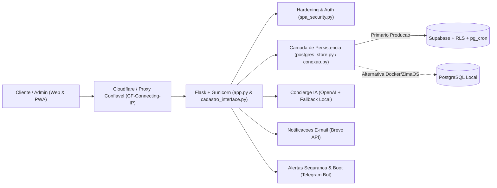

<div align="center">


<p>
  
  
  
  
  
  
  
  
</p>

<p>
  <strong>Aplicação web completa para gestão e experiência digital de um spa de bem-estar</strong> — unindo catálogo interativo, reservas em tempo real com lista de espera, clube de fidelidade com vouchers, controle atômico de estoque, dashboard analítico, concierge por IA e proteção em camadas contra abusos.
</p>

<p>
  <a href="#-sobre-o-projeto">Sobre</a> •
  <a href="#-funcionalidades-principais">Funcionalidades</a> •
  <a href="#-arquitetura-e-fluxo">Arquitetura</a> •
  <a href="#-segurança-e-confiabilidade">Segurança</a> •
  <a href="#-stack-e-estrutura-do-repositório">Stack & Estrutura</a> •
  <a href="#-principais-endpoints-da-api">API</a> •
  <a href="#-como-executar-e-testar">Como Rodar & Testar</a> •
  <a href="#-operação-produção-e-migrações-sql">Produção & SQL</a>
</p>

</div>

---

## ✨ Sobre o Projeto

O **Spa Panaceia** nasceu no contexto de **TCC de Ciência de Dados** e evoluiu para uma plataforma web em **Flask** pronta para produção, conectando a jornada acolhedora do cliente com rotinas administrativas robustas, idempotência transacional no banco de dados e telemetria operacional em tempo real.

| Experiência do Cliente | Gestão, Dados & Engenharia |
| :--- | :--- |
| Catálogo responsivo de tratamentos com **tema Claro/Escuro**, favoritos e animações suaves | **Dashboard Analítico** (`/api/admin/analytics`) com filtros por período e indicadores financeiros |
| **Agendamento inteligente** com calendário (`Flatpickr`), bloqueio anti-duplicidade e **lista de espera** | **Controle de Estoque Atômico & Idempotente** via `operacao_id` UUID (prevenção de baixa duplicada) |
| **Clube de Fidelidade** (`1 ponto a cada R$ 10` em atendimentos concluídos) + resgate de **vouchers** | **Auditoria completa de agenda** (`agenda_auditoria`), bloqueio de horários e cancelamento via `pg_cron` |
| **Concierge Virtual** com OpenAI (`gpt-4.1-mini`) + fallback local determinístico | **Hardening Web & Edge**: CSP com `nonce`, `TRUSTED_HOSTS`, Cloudflare IP real, HMAC-OTP e alertas no Telegram |
| **PWA instalável** (`/manifest.webmanifest`, `/spa-sw.js`) + portal de **Privacidade & LGPD** | **Banco flexível**: operação nativa com **Supabase** ou **PostgreSQL local** (Docker/ZimaOS), sem failover silencioso |

---

## 🚀 Funcionalidades Principais

### 🪷 Portal do Cliente
- **Catálogo de Serviços & Favoritos:** listagem dinâmica via `/api/servicos`, salvamento de tratamentos favoritos (`/api/favoritos`) e atalho de **repetir agendamento**.
- **Agendamento em Tempo Real:** seleção de data/hora com verificação instantânea de disponibilidade (`/api/horarios-ocupados`) e sincronização de relógio do servidor (`/api/relogio`).
- **Lista de Espera Automática:** se o horário estiver ocupado, o cliente entra na fila (`/api/lista-espera`) e recebe aviso por e-mail (Brevo) caso uma vaga seja liberada.
- **Clube de Fidelidade & Vouchers:** acompanhamento de saldo (`/api/usuario/pontos`), recompensas disponíveis (`/api/fidelidade`) e emissão/resgate de vouchers.
- **Avaliações Pós-Atendimento:** registro de feedback e nota para sessões concluídas (`/api/agendamentos/<id>/avaliar`).
- **Concierge Virtual com IA:** atendimento conversacional em `/api/chat` usando a API da OpenAI, com **fallback local automático** para manter o chat funcional mesmo sem chave externa configurada.
- **Privacidade & LGPD:** página dedicada em `/privacidade`, banner informativo não invasivo e exportação dos próprios dados pelo usuário em `/api/privacidade/exportar`.

### 🛠️ Painel Administrativo & Dados
- **Dashboard Analítico (`/api/admin/analytics`):** consolidação de agendamentos, receita e desempenho por serviço em janelas configuráveis (ex.: `30d` ou intervalo personalizado).
- **Agenda, Bloqueios & Auditoria:** visualização geral (`/api/admin/agendamentos`), criação/remoção de bloqueios de horários (`/api/admin/bloqueios`), histórico detalhado por reserva (`/api/admin/agendamentos/<id>/historico`) e conclusão transacional com crédito de pontos (`/api/admin/agendamentos/<id>/concluir`).
- **Baixa de Vouchers & Usuários:** validação/utilização de vouchers no balcão (`/api/admin/vouchers/utilizar`) e consulta administrativa de clientes (`/api/admin/usuarios`).
- **Estoque Seguro (`PUT /api/estoque/<id>/movimentar`):** movimentações protegidas contra cliques repetidos e timeouts de rede por chave de idempotência UUID e trava `CHECK (quantidade >= 0)`.
- **Utilitário Desktop de Planilhas (`dashboards/interface.py`):** ferramenta auxiliar em Python (`pandas` + `openpyxl` + `tkinter`) para converter exports CSV em planilhas Excel formatadas automaticamente.

---

## 🏗️ Arquitetura e Fluxo

> **Regra de integridade de dados:** **Supabase** e **PostgreSQL local** são tratados como bancos independentes (não há replicação automática entre eles). Por padrão, `DATABASE_FAILOVER_ENABLED=false` garante que não ocorram gravações divergentes caso o banco primário fique indisponível.



---

## 🛡️ Segurança e Confiabilidade

| Camada | Mecanismo Implementado | Detalhes Técnicos |
| :--- | :--- | :--- |
| **Autenticação & OTP** | `SecurityTools` (`database/spa_security.py`) | Códigos OTP com **HMAC-SHA256**, tokens de recuperação assinados (`URLSafeTimedSerializer`) com expiração persistente no banco e versionamento de sessão (`sessao_versao`) |
| **Anti-Abuso & Borda** | Rate limit + auto-quarentena + Cloudflare | Bloqueio automático imediato de scanners/User-Agents ofensivos (`seguranca.jsonl`), validação estrita de `TRUSTED_HOSTS`, suporte a `TRUSTED_PROXY_IPS`, `BLOCKED_IP_CIDRS` e `ALLOWED_COUNTRIES` |
| **CSP & Sessão Web** | Headers de segurança + cookies protegidos | Scripts inline protegidos por **`nonce` dinâmico** sem `on*=` inline em HTML, `SESSION_COOKIE_SECURE=true`, `SameSite=Lax`, HSTS e anti-CSRF |
| **Integridade na Agenda** | Advisory Locks + Triggers + `pg_cron` | `pg_advisory_xact_lock` + índice único `uq_agendamentos_horario_ativo` impedem reservas concorrentes; job `pg_cron` a cada 15 min cancela pendências vencidas com auditoria |
| **Integridade no Estoque** | Idempotência transacional | RPC `movimentar_estoque` grava `operacao_id` UUID e atualiza saldo na mesma transação (`FOR UPDATE`), barrando saldo negativo via constraint |
| **Observabilidade** | Telegram + Healthcheck JSON | Notificações instantâneas no Telegram em eventos de boot, logins e incidentes de segurança + monitoramento em `/api/health` |

---

## 🧰 Stack e Estrutura do Repositório

### Tecnologias Utilizadas
- **Backend:** Python `3.12`, Flask `3.1.0`, Gunicorn `23.0.0`, `flask-cors`, `python-dotenv`, `Werkzeug`
- **Banco & Dados:** PostgreSQL (`psycopg2-binary`), Supabase (`supabase==2.31.0`), Pandas `3.0.3`, NumPy `2.4.6`, OpenPyXL `3.1.5`
- **Integrações:** OpenAI (`openai==1.61.1`), Brevo API (`requests`), Telegram Bot API
- **Frontend:** HTML5, CSS3, JavaScript modularizado com build otimizado via `minify-html` (`scripts/build_frontend.py`), Google Fonts (`Inter` & `Manrope`), `Flatpickr`, Manifest & Service Worker (PWA)
- **Testes & Infra:** Python `unittest`, Node.js `node:test`, Docker (`python:3.12-slim`), `Procfile` (Render)

### Estrutura do Projeto

```text
projeto-site/
├── app.py                              # Ponto de entrada único Gunicorn/Flask (app:app)
├── database/
│   ├── cadastro_interface.py           # Núcleo Flask: rotas web, API cliente/admin, segurança e Telegram
│   ├── spa_security.py                 # Criptografia HMAC-OTP, tokens de recuperação e rate limiting
│   ├── postgres_store.py / conexao.py  # Adaptador PostgreSQL local e cliente Supabase
│   ├── multiplos_usuarios.py           # Suporte operacional multiusuário
│   ├── servicos.html / .min.html       # Portal principal do Spa (catálogo, agenda, fidelidade, admin)
│   └── index.html
├── templates/                          # index, privacidade, 404 (+ versões .min.html)
├── static/
│   ├── css/                            # privacy-notice.css / .min.css
│   ├── js/                             # privacy-notice.js, registration.js (+ versões .min.js)
│   └── img/                            # Identidade visual (logo_panaceia.png)
├── scripts/
│   └── build_frontend.py               # Gera ativos .min.html, .min.css e .min.js mantendo fontes legíveis
├── migrations/
│   └── 001_security_hardening.sql      # Migração idempotente de expiração/tentativas OTP e sessão
├── dashboards/
│   └── interface.py                    # Utilitário desktop (Tkinter + OpenPyXL) para CSV → XLSX formatado
├── tests/                              # Suítes de teste Python (unittest) e JavaScript (node:test / CSP)
├── Dockerfile & Procfile               # Empacotamento Docker (porta 5000) e deploy Render (1 worker / 8 threads)
├── requirements.txt                    # Dependências de runtime
└── requirements-build.txt              # Dependência isolada de build frontend (minify-html)
```

---

## 📡 Principais Endpoints da API

| Categoria | Rota | Descrição |
| :--- | :--- | :--- |
| **Público & PWA** | `GET /`, `/cadastro`, `/privacidade`, `/api/servicos`, `/api/horarios-ocupados`, `/api/relogio`, `/manifest.webmanifest`, `/spa-sw.js` | Páginas, catálogo, horários livres, relógio oficial e manifesto PWA |
| **Diagnóstico & SEO** | `GET /api/health`, `/robots.txt`, `/sitemap.xml` | Status do banco ativo, restrições de agenda, status do Telegram e SEO canônico |
| **Autenticação** | `POST /cadastrar`, `/api/validar-codigo`, `/api/reenviar-codigo`, `/api/login`, `/api/logout`, `/api/esqueci-senha`, `/api/redefinir-senha`, `GET /api/me` | Fluxo completo de conta, OTP por e-mail, sessão segura e recuperação de senha |
| **Cliente** | `POST /api/agendar`, `GET /api/meus-agendamentos`, `PUT/DELETE /api/agendamentos/<id>`, `POST .../avaliar`, `GET/POST/DELETE /api/lista-espera`, `GET/POST/DELETE /api/favoritos/<id>`, `GET /api/fidelidade`, `POST /api/fidelidade/resgatar`, `GET /api/usuario/pontos`, `GET /api/privacidade/exportar`, `POST /api/chat` | Reservas, avaliações, espera, favoritos, pontos/vouchers, LGPD e Concierge IA |
| **Administração** | `GET /api/admin/agendamentos`, `GET /api/admin/analytics`, `GET/POST/DELETE /api/admin/bloqueios`, `GET /api/admin/agendamentos/<id>/historico`, `POST /api/admin/agendamentos/<id>/concluir`, `POST /api/admin/vouchers/utilizar`, `GET /api/admin/usuarios`, `GET/POST /api/estoque`, `PUT /api/estoque/<id>/movimentar`, `DELETE /api/estoque/<id>` | Gestão executiva, analytics, agenda, créditos transacionais, vouchers e estoque atômico |

---

## 💻 Como Executar e Testar

### 1. Desenvolvimento Local

> Exige configurar ao menos um banco (`DB_*` para PostgreSQL local **ou** `SUPABASE_URL` + `SUPABASE_SERVICE_ROLE_KEY`). Em HTTP local sem TLS, defina `APP_ENV=development` e `SESSION_COOKIE_SECURE=false`.

```powershell
python -m pip install -r requirements.txt
$env:APP_ENV = "development"
$env:SESSION_COOKIE_SECURE = "false"
python app.py
```

### 2. Gerar Ativos Minificados do Frontend (após editar HTML/CSS/JS)

Os arquivos-fonte permanecem legíveis; gere as versões `.min.*` e versione ambos em conjunto:

```bash
python -m pip install -r requirements-build.txt
python scripts/build_frontend.py
```

### 3. Executar as Suítes de Teste

```bash
# Testes Python (rotas, projeção PostgreSQL, contratos de estoque, auditoria de segurança)
python -m unittest discover -s tests -p "test_*.py"

# Testes JavaScript (CSP sem inline handlers, registro, perfil paralelo, idempotência de estoque)
node --test tests/*.test.js
```

### 4. Container Docker (Alternativa Local / ZimaOS)

```bash
docker build -t spa-panaceia .
docker run -d --name panaceia-spa --restart unless-stopped -p 5000:5000 --env-file database.env spa-panaceia
```

---

## 📚 Operação, Produção e Migrações SQL

Os detalhes completos de infraestrutura, variáveis de ambiente, estado verificado de deploy, rotinas de atualização no ZimaOS e scripts SQL transacionais do Supabase ficam organizados abaixo para consulta rápida:

<details>
<summary><strong>1. Arquitetura de Produção & Estado do Deploy Verificado</strong></summary>

- **Deploy ativo verificado:** Render, com aplicação Flask servida via Gunicorn (`Procfile` com `--workers 1 --threads 8 --timeout 60`).
- **Banco ativo confirmado:** Supabase (`DATABASE_PRIMARY=supabase`, `DATABASE_FAILOVER_ENABLED=false`).
- **PostgreSQL local em Docker/ZimaOS:** alternativa operacional documentada via `Dockerfile`; os dois bancos são independentes e não possuem sincronização automática (mantenha `DATABASE_FAILOVER_ENABLED=false` sem um plano testado de reconciliação).
- **Verificação pública pré-publicação registrada em 07/10/2026:**
  - `https://spa-panaceia.onrender.com/` respondeu HTTP `200` com TLS válido; healthcheck apontou Supabase como banco ativo.
  - `https://spapanaceia.com.br/` e `https://www.spapanaceia.com.br/` responderam HTTP `530` do Cloudflare na ocasião (TLS de borda válido; origem própria pendente de conferência após ajustes de DNS/origem).
  - `https://panaceia.onrender.com/` refere-se a um serviço separado chamado `PANACEIA`, não ao serviço `Spa Panaceia`.
- **Ativos, SEO & Privacidade:**
  - Página principal servida de `database/servicos.html`; templates em `templates/`; logo e favicon SVG leve nativo em `/app-icon.svg`.
  - Analytics desativado por padrão; o aviso em `/privacidade` documenta armazenamento funcional e pontos que dependem de definição humana.
  - `PUBLIC_SITE_URL` só emite canonical/`og:url`/sitemap quando a URL HTTPS corresponde a um host confiável pelo backend (sem ela, `/sitemap.xml` retorna `503` intencionalmente).

</details>

<details>
<summary><strong>2. Modelo de Variáveis de Ambiente (.env) & Regras de Proxy</strong></summary>

No Render, configure diretamente no ambiente do serviço (`DATABASE_PRIMARY=supabase`, `DATABASE_FAILOVER_ENABLED=false`, `SUPABASE_URL`, `SUPABASE_SERVICE_ROLE_KEY`, `FLASK_SECRET_KEY`). O exemplo abaixo ilustra a alternativa Docker/ZimaOS com PostgreSQL local — **nunca coloque segredos reais no Git ou neste README**:

```env
APP_ENV=production
FLASK_SECRET_KEY=<segredo-aleatorio-longo>

DB_HOST=postgres
DB_PORT=5432
DB_NAME=site_db
DB_USER=site_user
DB_PASSWORD=<senha-exclusiva-do-site>
DB_CONNECT_TIMEOUT=10
DB_POOL_MIN=1
DB_POOL_MAX=10

# Banco principal e tempo de espera antes de testar novamente um banco offline.
DATABASE_PRIMARY=postgres
DATABASE_FAILOVER_ENABLED=false
DB_FAILOVER_COOLDOWN_SECONDS=60

# Contingência Supabase. A service role fica somente no backend.
SUPABASE_URL=https://SEU-PROJETO.supabase.co
SUPABASE_SERVICE_ROLE_KEY=<service-role-do-servidor>

SPA_TIMEZONE=America/Sao_Paulo
SESSION_COOKIE_SECURE=true
SESSION_COOKIE_SAMESITE=Lax
SESSION_TTL_HOURS=12

CORS_ORIGINS=https://spapanaceia.com.br,https://www.spapanaceia.com.br
TRUSTED_HOSTS=spapanaceia.com.br,www.spapanaceia.com.br,localhost,127.0.0.1
TRUSTED_PROXY_IP_HEADER=CF-Connecting-IP
# CIDRs dos proxies que realmente chegam ao container (mantenha a lista atualizada).
TRUSTED_PROXY_IPS=<cidr-do-proxy-1>,<cidr-do-proxy-2>
# Opcional: IPs/redes a bloquear diretamente no backend.
BLOCKED_IP_CIDRS=<ip-ou-cidr-bloqueado>
# Opcional: restringe o site aos países informados; só funciona atrás do proxy confiável.
# ALLOWED_COUNTRIES=BR
# Opcional: cabeçalho definido pelo proxy confiável para tráfego VPN/anônimo.
# TRUSTED_VPN_HEADER=X-Spa-VPN

BREVO_API_KEY=<chave-brevo>
BREVO_SENDER_NAME=Spa Panaceia
BREVO_SENDER_EMAIL=<remetente-verificado>
SPA_ALERT_EMAIL=<caixa-da-equipe-que-recebe-alertas>

# Alertas operacionais e de segurança no Telegram
TELEGRAM_BOT_TOKEN=<token-do-bot-telegram>
TELEGRAM_CHAT_ID=<id-do-chat-telegram>

OPENAI_API_KEY=<chave-openai>
OPENAI_MODEL=gpt-4.1-mini
LOG_LEVEL=INFO
```

**Regras operacionais de proxy e failover:**
- Nunca utilize chave `anon`/publicável no backend; use exclusivamente `SUPABASE_SERVICE_ROLE_KEY`.
- `TRUSTED_PROXY_IP_HEADER` (`CF-Connecting-IP`) só é aceito quando `REMOTE_ADDR` pertence a `TRUSTED_PROXY_IPS` ([faixas oficiais Cloudflare](https://developers.cloudflare.com/fundamentals/concepts/cloudflare-ip-addresses/)).
- `TRUSTED_HOSTS` rejeita `Host` não listado com HTTP `400`. Para testes HTTP locais em IP privado, use `APP_ENV=development` isoladamente.
- `ALLOWED_COUNTRIES=BR` exige `CF-IPCountry` habilitado no Cloudflare atrás de proxy confiável; `TRUSTED_VPN_HEADER` depende de regra de WAF/proxy configurada.
- Bloqueios adaptativos e limites de login residem na memória do único worker Gunicorn: mantenha WAF/rate limiting também na borda.
- **Comportamento entre os dois bancos:** leituras com falha de conexão podem tentar contingência apenas se `DATABASE_FAILOVER_ENABLED=true`; gravações que falharem após envio nunca são repetidas para evitar duplicidade, e erros de negócio nunca disparam failover.

</details>

<details>
<summary><strong>3. Atualização em Produção via ZimaOS (Docker)</strong></summary>

Confirme antes que `TELEGRAM_BOT_TOKEN` e `TELEGRAM_CHAT_ID` estão presentes em `database.env` sem `\r\n` (CRLF):

```bash
cd /DATA/AppData/projetos/tcc-ciencia-de-dados && git stash && git pull origin main && sudo docker --config /DATA/.docker image build --no-cache -t tcc-panaceia . && (sudo docker stop panaceia-spa; sudo docker rm panaceia-spa) && sudo docker run -d --name panaceia-spa --restart unless-stopped -p 5000:5000 --env-file /DATA/AppData/projetos/tcc-ciencia-de-dados/database.env tcc-panaceia
```

Verificação pós-deploy:

```bash
curl -fsS http://127.0.0.1:5000/api/health
sudo docker logs --tail 50 panaceia-spa
```

Esperado no JSON e logs: `"telegram_configurado": true`, `INFO:spa.telegram:Notificações do Telegram configuradas` e `INFO:spa.telegram:Alerta entregue ao Telegram com sucesso`.

</details>

<details>
<summary><strong>4. SQL — Agenda, Lista de Espera, Auditoria e Bloqueio de Horários</strong></summary>

O PostgreSQL local cria as tabelas no startup; no **Supabase**, execute no **SQL Editor** com RLS estrito (`service_role` apenas):

```sql
CREATE TABLE IF NOT EXISTS public.agenda_lista_espera (
    id BIGSERIAL PRIMARY KEY,
    email_cliente TEXT NOT NULL,
    servico_id BIGINT NOT NULL,
    data_atendimento TIMESTAMP WITHOUT TIME ZONE NOT NULL,
    status TEXT NOT NULL DEFAULT 'Aguardando'
        CHECK (status IN ('Aguardando', 'Notificando', 'Notificado', 'Cancelado')),
    criado_em TIMESTAMPTZ NOT NULL DEFAULT NOW(),
    notificado_em TIMESTAMPTZ
);
CREATE UNIQUE INDEX IF NOT EXISTS uq_agenda_lista_espera_email_horario
    ON public.agenda_lista_espera (email_cliente, data_atendimento)
    WHERE status IN ('Aguardando', 'Notificando', 'Notificado');
CREATE INDEX IF NOT EXISTS ix_agenda_lista_espera_horario_status
    ON public.agenda_lista_espera (data_atendimento, status);

CREATE TABLE IF NOT EXISTS public.agenda_auditoria (
    id BIGSERIAL PRIMARY KEY,
    agendamento_id BIGINT NOT NULL,
    ator_email TEXT NOT NULL,
    ator_tipo TEXT NOT NULL CHECK (ator_tipo IN ('admin', 'cliente')),
    acao TEXT NOT NULL,
    data_anterior TEXT,
    data_nova TEXT,
    status_anterior TEXT,
    status_novo TEXT,
    criado_em TIMESTAMPTZ NOT NULL DEFAULT NOW()
);
ALTER TABLE public.agenda_auditoria
    ADD COLUMN IF NOT EXISTS status_anterior TEXT,
    ADD COLUMN IF NOT EXISTS status_novo TEXT;
CREATE INDEX IF NOT EXISTS ix_agenda_auditoria_agendamento_data
    ON public.agenda_auditoria (agendamento_id, criado_em DESC);

ALTER TABLE public.agenda_lista_espera ENABLE ROW LEVEL SECURITY;
ALTER TABLE public.agenda_auditoria ENABLE ROW LEVEL SECURITY;
REVOKE ALL ON public.agenda_lista_espera, public.agenda_auditoria FROM PUBLIC, anon, authenticated;
GRANT ALL ON public.agenda_lista_espera, public.agenda_auditoria TO service_role;
GRANT USAGE, SELECT ON SEQUENCE public.agenda_lista_espera_id_seq, public.agenda_auditoria_id_seq TO service_role;
```

**Bloqueio de horários + triggers anti-duplicidade com advisory lock:**

```sql
CREATE TABLE IF NOT EXISTS public.agenda_bloqueios (
    id BIGSERIAL PRIMARY KEY,
    data_atendimento TIMESTAMP WITHOUT TIME ZONE NOT NULL,
    motivo TEXT NOT NULL,
    criado_por TEXT NOT NULL,
    criado_em TIMESTAMPTZ NOT NULL DEFAULT NOW()
);
CREATE UNIQUE INDEX IF NOT EXISTS uq_agenda_bloqueios_horario
    ON public.agenda_bloqueios (data_atendimento);
-- Garante uma única reserva ativa por horário mesmo sob requisições simultâneas.
CREATE UNIQUE INDEX IF NOT EXISTS uq_agendamentos_horario_ativo
    ON public.agendamentos (data_atendimento)
    WHERE status IS DISTINCT FROM 'Cancelado';

CREATE OR REPLACE FUNCTION public.verificar_bloqueio_ao_reservar()
RETURNS trigger LANGUAGE plpgsql SECURITY DEFINER
SET search_path = public, pg_temp AS $$
BEGIN
    IF NEW.status IS DISTINCT FROM 'Cancelado' THEN
        PERFORM pg_advisory_xact_lock(hashtextextended(
            to_char(NEW.data_atendimento, 'YYYY-MM-DD"T"HH24:MI'), 0));
        IF EXISTS (
            SELECT 1 FROM public.agenda_bloqueios
            WHERE data_atendimento = NEW.data_atendimento
        ) THEN
            RAISE EXCEPTION 'AGENDA_BLOQUEADA' USING ERRCODE = 'P0001';
        END IF;
        IF EXISTS (
            SELECT 1 FROM public.agendamentos
            WHERE data_atendimento = NEW.data_atendimento
              AND id IS DISTINCT FROM NEW.id
              AND status IS DISTINCT FROM 'Cancelado'
        ) THEN
            RAISE EXCEPTION 'AGENDA_RESERVADA' USING ERRCODE = 'P0001';
        END IF;
    END IF;
    RETURN NEW;
END;
$$;
DO $$
BEGIN
    IF NOT EXISTS (
        SELECT 1 FROM pg_trigger
        WHERE tgname = 'trg_agendamentos_respeitar_bloqueio'
          AND tgrelid = 'public.agendamentos'::regclass
    ) THEN
        CREATE TRIGGER trg_agendamentos_respeitar_bloqueio
        BEFORE INSERT OR UPDATE OF data_atendimento, status
        ON public.agendamentos FOR EACH ROW
        EXECUTE FUNCTION public.verificar_bloqueio_ao_reservar();
    END IF;
END;
$$;

CREATE OR REPLACE FUNCTION public.verificar_reserva_ao_bloquear()
RETURNS trigger LANGUAGE plpgsql SECURITY DEFINER
SET search_path = public, pg_temp AS $$
BEGIN
    PERFORM pg_advisory_xact_lock(hashtextextended(
        to_char(NEW.data_atendimento, 'YYYY-MM-DD"T"HH24:MI'), 0));
    IF EXISTS (
        SELECT 1 FROM public.agendamentos
        WHERE data_atendimento = NEW.data_atendimento
          AND status IS DISTINCT FROM 'Cancelado'
    ) THEN
        RAISE EXCEPTION 'AGENDA_RESERVADA' USING ERRCODE = 'P0001';
    END IF;
    RETURN NEW;
END;
$$;
DO $$
BEGIN
    IF NOT EXISTS (
        SELECT 1 FROM pg_trigger
        WHERE tgname = 'trg_agenda_bloqueios_sem_reservas'
          AND tgrelid = 'public.agenda_bloqueios'::regclass
    ) THEN
        CREATE TRIGGER trg_agenda_bloqueios_sem_reservas
        BEFORE INSERT OR UPDATE OF data_atendimento
        ON public.agenda_bloqueios FOR EACH ROW
        EXECUTE FUNCTION public.verificar_reserva_ao_bloquear();
    END IF;
END;
$$;

ALTER TABLE public.agenda_bloqueios ENABLE ROW LEVEL SECURITY;
REVOKE ALL ON public.agenda_bloqueios FROM PUBLIC, anon, authenticated;
REVOKE ALL ON FUNCTION public.verificar_bloqueio_ao_reservar(),
    public.verificar_reserva_ao_bloquear() FROM PUBLIC, anon, authenticated;
GRANT ALL ON public.agenda_bloqueios TO service_role;
GRANT USAGE, SELECT ON SEQUENCE public.agenda_bloqueios_id_seq TO service_role;
```

> **Checagem rápida:** no PostgreSQL local, se `/api/health` retornar `"restricao_agenda": false`, verifique duplicatas (`GROUP BY data_atendimento HAVING COUNT(*) > 1`) e crie `uq_agendamentos_horario_ativo`. No Supabase, `restricao_agenda` retorna `null` (`restricao_agenda_verificavel: false`) pois a Data API não lê catálogos DDL diretamente — confira os objetos no SQL Editor.

</details>

<details>
<summary><strong>5. SQL — Crédito Transacional de Pontos, Cancelamento Automático (pg_cron) & Estoque Idempotente</strong></summary>

#### Conclusão transacional de atendimento (`POST /api/admin/agendamentos/<id>/concluir`)

Calcula `trunc(valor / 10)` a partir de `servico.valor`, soma pontos em `usuarios` e altera status para `Concluido` na mesma transação (`FOR UPDATE`):

```sql
BEGIN;

CREATE OR REPLACE FUNCTION public.concluir_agendamento_creditar_pontos(p_agendamento_id integer)
RETURNS TABLE(resultado text, pontos integer)
LANGUAGE plpgsql
SECURITY DEFINER
SET search_path TO pg_catalog, public
AS $function$
DECLARE
    v_email text;
    v_servico_id integer;
    v_status text;
    v_valor numeric;
    v_pontos integer;
BEGIN
    SELECT a.email_cliente, a.servico_id, a.status
      INTO v_email, v_servico_id, v_status
      FROM public.agendamentos AS a
     WHERE a.id = p_agendamento_id
     FOR UPDATE;

    IF NOT FOUND THEN
        RETURN QUERY SELECT 'nao_encontrado'::text, 0;
        RETURN;
    END IF;
    IF v_status = 'Concluido' THEN
        RETURN QUERY SELECT 'ja_concluido'::text, 0;
        RETURN;
    END IF;
    IF v_status IS DISTINCT FROM 'Pendente' THEN
        RETURN QUERY SELECT 'status_invalido'::text, 0;
        RETURN;
    END IF;

    SELECT s.valor INTO v_valor
      FROM public.servico AS s
     WHERE s.id = v_servico_id;
    IF NOT FOUND OR v_valor IS NULL OR v_valor < 0 THEN
        RAISE EXCEPTION 'Servico sem valor valido para credito de pontos';
    END IF;
    v_pontos := trunc(v_valor / 10)::integer;

    UPDATE public.usuarios AS u
       SET pontos = coalesce(u.pontos, 0) + v_pontos
     WHERE u.email = v_email;
    IF NOT FOUND THEN
        RAISE EXCEPTION 'Cliente nao encontrado para credito de pontos';
    END IF;

    UPDATE public.agendamentos
       SET status = 'Concluido'
     WHERE id = p_agendamento_id AND status = 'Pendente';
    IF NOT FOUND THEN
        RAISE EXCEPTION 'Falha ao concluir agendamento apos credito';
    END IF;

    RETURN QUERY SELECT 'concluido'::text, v_pontos;
END;
$function$;

REVOKE ALL ON FUNCTION public.concluir_agendamento_creditar_pontos(integer)
    FROM PUBLIC, anon, authenticated;
GRANT EXECUTE ON FUNCTION public.concluir_agendamento_creditar_pontos(integer)
    TO service_role;
NOTIFY pgrst, 'reload schema';

COMMIT;
```

#### Cancelamento automático de pendências vencidas via `pg_cron` (a cada 15 min em `America/Sao_Paulo`)

```sql
BEGIN;

CREATE EXTENSION IF NOT EXISTS pg_cron;

ALTER TABLE public.agenda_auditoria
    DROP CONSTRAINT agenda_auditoria_ator_tipo_check;
ALTER TABLE public.agenda_auditoria
    ADD CONSTRAINT agenda_auditoria_ator_tipo_check
    CHECK (ator_tipo IN ('admin', 'cliente', 'sistema'));

CREATE OR REPLACE FUNCTION public.cancelar_agendamentos_vencidos(p_desde date)
RETURNS integer
LANGUAGE plpgsql
SECURITY DEFINER
SET search_path TO pg_catalog, public
AS $function$
DECLARE
    v_hoje date := (statement_timestamp() AT TIME ZONE 'America/Sao_Paulo')::date;
    v_agendamento record;
    v_data_anterior text;
    v_cancelados integer := 0;
BEGIN
    IF p_desde IS NULL THEN
        RAISE EXCEPTION 'Data de ativação obrigatória';
    END IF;

    FOR v_agendamento IN
        SELECT a.id
          FROM public.agendamentos AS a
         WHERE a.status = 'Pendente'
           AND a.data_atendimento < v_hoje::timestamp
           AND a.data_atendimento >= p_desde::timestamp
         ORDER BY a.data_atendimento, a.id
         FOR UPDATE OF a SKIP LOCKED
    LOOP
        UPDATE public.agendamentos AS a
           SET status = 'Cancelado'
         WHERE a.id = v_agendamento.id
           AND a.status = 'Pendente'
        RETURNING a.data_atendimento::text INTO v_data_anterior;

        IF FOUND THEN
            INSERT INTO public.agenda_auditoria (
                agendamento_id, ator_email, ator_tipo, acao,
                data_anterior, status_anterior, status_novo
            ) VALUES (
                v_agendamento.id, 'sistema', 'sistema',
                'cancelamento_automatico', v_data_anterior,
                'Pendente', 'Cancelado'
            );
            v_cancelados := v_cancelados + 1;
        END IF;
    END LOOP;

    RETURN v_cancelados;
END;
$function$;

REVOKE ALL ON FUNCTION public.cancelar_agendamentos_vencidos(date)
    FROM PUBLIC, anon, authenticated, service_role;

DO $schedule$
DECLARE
    v_ativacao date := (statement_timestamp() AT TIME ZONE 'America/Sao_Paulo')::date;
BEGIN
    IF NOT EXISTS (
        SELECT 1 FROM cron.job
         WHERE jobname = 'spa-cancelar-agendamentos-vencidos'
    ) THEN
        PERFORM cron.schedule(
            'spa-cancelar-agendamentos-vencidos',
            '*/15 * * * *',
            format(
                'SELECT public.cancelar_agendamentos_vencidos(%L::date)',
                v_ativacao
            )
        );
    END IF;
END;
$schedule$;

COMMIT;
```

#### Movimentação atômica e idempotente de estoque (`PUT /api/estoque/<id>/movimentar`)

```sql
BEGIN;

ALTER TABLE public.estoque
    ADD CONSTRAINT estoque_quantidade_nao_negativa CHECK (quantidade >= 0);

CREATE TABLE public.estoque_movimentacoes (
    operacao_id uuid PRIMARY KEY,
    item_id bigint NOT NULL,
    delta integer NOT NULL CHECK (delta <> 0),
    resultado jsonb NOT NULL,
    criado_em timestamptz NOT NULL DEFAULT now()
);
ALTER TABLE public.estoque_movimentacoes ENABLE ROW LEVEL SECURITY;
REVOKE ALL ON TABLE public.estoque_movimentacoes
    FROM PUBLIC, anon, authenticated, service_role;

CREATE OR REPLACE FUNCTION public.movimentar_estoque(
    p_item_id bigint,
    p_delta integer,
    p_operacao_id uuid
)
RETURNS jsonb
LANGUAGE plpgsql
SECURITY DEFINER
SET search_path TO pg_catalog, public
AS $function$
DECLARE
    v_inserted integer;
    v_previous_item_id bigint;
    v_previous_delta integer;
    v_result jsonb;
BEGIN
    IF p_operacao_id IS NULL OR p_item_id IS NULL OR p_delta IS NULL OR p_delta = 0 THEN
        RAISE EXCEPTION 'ESTOQUE_ARGUMENTO_INVALIDO' USING ERRCODE = '22023';
    END IF;

    INSERT INTO public.estoque_movimentacoes (operacao_id, item_id, delta, resultado)
    VALUES (p_operacao_id, p_item_id, p_delta, '{}'::jsonb)
    ON CONFLICT (operacao_id) DO NOTHING;
    GET DIAGNOSTICS v_inserted = ROW_COUNT;

    IF v_inserted = 0 THEN
        SELECT m.item_id, m.delta, m.resultado
          INTO v_previous_item_id, v_previous_delta, v_result
          FROM public.estoque_movimentacoes AS m
         WHERE m.operacao_id = p_operacao_id
         FOR UPDATE;

        IF v_previous_item_id IS DISTINCT FROM p_item_id
           OR v_previous_delta IS DISTINCT FROM p_delta THEN
            RAISE EXCEPTION 'ESTOQUE_OPERACAO_DIVERGENTE' USING ERRCODE = 'P0001';
        END IF;
        IF v_result IS NULL OR v_result = '{}'::jsonb THEN
            RAISE EXCEPTION 'ESTOQUE_OPERACAO_INCOMPLETA' USING ERRCODE = 'P0001';
        END IF;
        RETURN v_result || jsonb_build_object('repetida', true);
    END IF;

    UPDATE public.estoque AS e
       SET quantidade = (e.quantidade::bigint + p_delta)::integer
     WHERE e.id = p_item_id
       AND e.quantidade::bigint + p_delta BETWEEN 0 AND 2147483647
    RETURNING jsonb_build_object(
        'id', e.id,
        'nome', e.nome,
        'quantidade', e.quantidade,
        'quantidade_minima', e.quantidade_minima,
        'unidade', e.unidade
    ) INTO v_result;

    IF v_result IS NULL THEN
        IF EXISTS (SELECT 1 FROM public.estoque AS e WHERE e.id = p_item_id) THEN
            RAISE EXCEPTION 'ESTOQUE_INSUFICIENTE' USING ERRCODE = 'P0001';
        ELSE
            RAISE EXCEPTION 'ESTOQUE_NAO_ENCONTRADO' USING ERRCODE = 'P0001';
        END IF;
    END IF;

    v_result := v_result || jsonb_build_object('repetida', false);
    UPDATE public.estoque_movimentacoes AS m
       SET resultado = v_result
     WHERE m.operacao_id = p_operacao_id;

    RETURN v_result;
END;
$function$;

REVOKE ALL ON FUNCTION public.movimentar_estoque(bigint, integer, uuid)
    FROM PUBLIC, anon, authenticated;
GRANT EXECUTE ON FUNCTION public.movimentar_estoque(bigint, integer, uuid)
    TO service_role;
NOTIFY pgrst, 'reload schema';

COMMIT;
```

> **Migração de endurecimento (`migrations/001_security_hardening.sql`):** adiciona colunas não destrutivas em `public.usuarios` (`token_recuperacao_expira_em`, `token_recuperacao_tentativas`, `codigo_otp_tentativas`, `sessao_versao`). Aplicada automaticamente no PostgreSQL local por `ensure_schema()`; no Supabase, execute o arquivo no **SQL Editor**.

</details>

<details>
<summary><strong>6. Checklist de Segurança & Backups</strong></summary>

- [x] Nenhum segredo incluído no README ou versionado no Git (`database.env` fora da imagem e ignorado).
- [x] Credenciais de produção configuradas somente no ambiente do provedor (Render) ou `--env-file` no servidor.
- [x] Senha forte e exclusiva para usuários de banco e administrador.
- [x] HTTPS, HSTS, CSP com `nonce` e cookies `Secure` + `SameSite=Lax` ativos.
- [x] `/api/health` e alertas do Telegram monitorados.
- [x] Conferência periódica da política de backups e retenção no painel do Supabase.

</details>

---

<div align="center">
  
</div>
